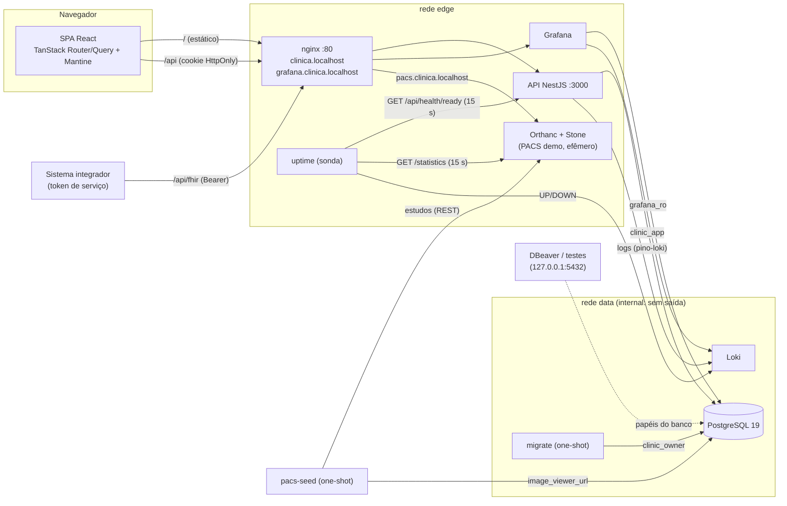
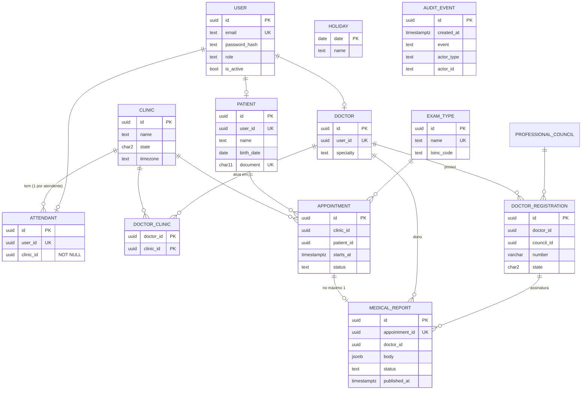
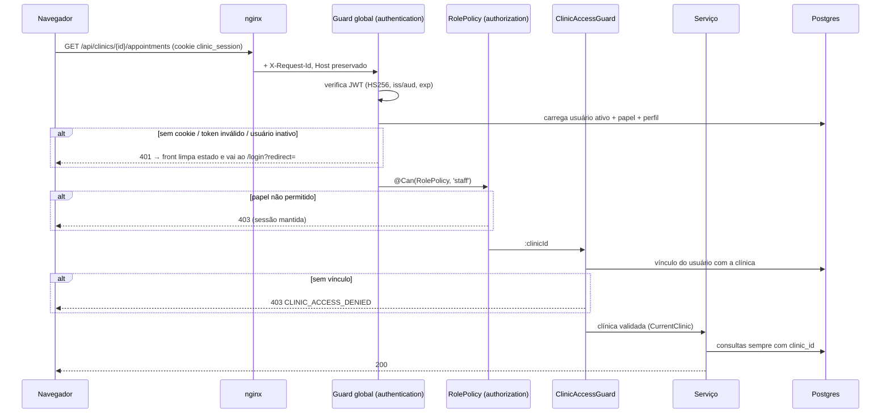

# Arquitetura

Público: avaliadores técnicos e quem for manter o projeto.

## Componentes



- **Único ponto de entrada:** nginx (porta 80). Front e API na mesma origem → cookie `SameSite=Strict`, sem CORS.
- **Rede `data` interna:** sem rota para fora; o nginx não alcança o banco. O Loki não publica porta.
- **PACS de demonstração:** Orthanc sem volume e sem autenticação (escopo de demonstração); o `pacs-seed` gera um estudo por agendamento ativo na subida e grava a URL do Stone na tabela; o navegador abre essa URL direto, sem passar pelo backend.
- **Disponibilidade:** a sonda `uptime` (container à parte, Node sem dependências) consulta o readiness da API e grava o resultado no Loki — se o backend cair, quem registra a queda é ela.
- **Banco em `127.0.0.1:5432`:** publicado só na máquina local para facilitar a avaliação (DBeaver, `make db-*`, testes). Em produção, removeria-se a porta; os papéis com privilégio mínimo continuam valendo.

## Modelo de dados



Convenções: IDs **UUID v7** (`uuidv7()` nativo); `created_at`/`updated_at` em todas as tabelas (classe base do TypeORM + trigger `set_updated_at()`), exceto `audit_event` (append-only, só `created_at`).

Restrições que carregam regras de negócio:

| Restrição | Regra |
|---|---|
| `UNIQUE (clinic_id, starts_at) WHERE status = 'SCHEDULED'` | Sala única por clínica; concorrência; horário cancelado reutilizável |
| `UNIQUE (patient_id, starts_at) WHERE status = 'SCHEDULED'` | Paciente não está em dois exames ao mesmo tempo (em qualquer clínica) |
| `UNIQUE (medical_report.appointment_id)` | Um laudo por agendamento; trava contra dois médicos |
| `CHECK (extract(epoch FROM starts_at) % 1800 = 0)` | Slots de 30 min alinhados, independente do fuso da sessão |
| `UNIQUE (council_id, state, number)` | Um registro profissional pertence a um só médico |
| `CHECK` de publicação | Publicado exige `published_at`, registro e snapshots de assinatura |
| `attendant.clinic_id NOT NULL` + `user_id UNIQUE` | Atendente em exatamente uma clínica |

## Estrutura do backend

```
src/
  auth/              login/logout/me, providers (cookie e token de serviço), RolePolicy, token JWT
  clinics/           /me/clinics, ClinicAccessGuard (isolamento multi-tenant)
  catalog/           tipos de exame e feriados
  patients/          busca por nome/CPF
  appointments/      regras de agenda (booking-rules.ts, função pura), CRUD, slots
  medical-reports/   rascunho, publicação, schema do corpo (lista fechada), HTML do laudo
  patient-portal/    /me/appointments e /me/medical-reports/:id
  fhir/              mapeamento FHIR R4 (função pura) e rota do serviço de integração
  audit/             AuditService (auditoria na mesma transação + log após commit)
  observability/     configuração do pino (redação LGPD, contrato de logs)
  database/          entidades, migrations, seed, data source
  common/            fusos, erros padronizados, request-id, validação
```

Controllers só tratam HTTP; regras ficam nos serviços e em funções puras (`booking-rules.ts`, `report-body.ts`, `fhir.mapper.ts`), testadas sem banco.

## Fluxo de autenticação e resolução de clínica



## Decisões técnicas (ADRs resumidas)

| # | Decisão | Por quê | Alternativas descartadas |
|---|---|---|---|
| 1 | NestJS 12 + pacotes oficiais de auth | Guard global, deny-by-default, `PasswordHasher` com tempo constante | Passport + `@nestjs/jwt` montados à mão |
| 2 | TypeORM com **migrations SQL à mão** | Índices parciais, CHECKs, trigger e GRANTs que o ORM não gera bem | `synchronize`, migrations geradas |
| 3 | Unicidade e concorrência **no banco** | Correto sob requisições simultâneas, sem *check-then-insert* | Verificar antes de inserir na aplicação |
| 4 | JWT em cookie HttpOnly, 1 h, sem refresh | Token inacessível a XSS; simples | Bearer + localStorage; sessão no servidor |
| 5 | Papel **fora** do token | Desativação/mudança de papel vale na hora | Claims de papel no JWT |
| 6 | Multi-tenant por coluna + guard | 4 clínicas, dashboards e migrations simples | Schema/banco por clínica; RLS (evolução) |
| 7 | 403 para acesso indevido | Pedido do enunciado/negócio | 404 (esconderia a existência) |
| 8 | Laudo em JSON do Tiptap validado | Lista fechada sem sanitizar HTML; sem XSS | HTML (CKEditor) + sanitização |
| 9 | O rascunho é a trava do atendimento | Persistente, auditável, garantido por índice | Lock temporário com expiração |
| 10 | Auditoria na mesma transação | Histórico confiável, sem eventos fantasmas | Só logs |
| 11 | Grafana + Loki, logs via `pino-loki` | O próprio backend envia os logs: sem socket do Docker nem agente extra | Alloy/Promtail |
| 12 | FHIR R4 base + token de serviço fixo | Interoperável e simples | Perfis BR Core/RNDS, chaves com tabela |

## Contrato de erros

Todas as respostas de erro (inclusive 401 dos guards e 429 do throttler):

```json
{ "statusCode": 409, "code": "SLOT_TAKEN", "message": "Este horário já está ocupado nesta clínica." }
```

| Status | Códigos |
|---|---|
| 400 | `VALIDATION_ERROR` (com `details.issues`) |
| 401 | `UNAUTHENTICATED`, `INVALID_CREDENTIALS` |
| 403 | `FORBIDDEN`, `CLINIC_ACCESS_DENIED`, `APPOINTMENT_OTHER_CLINIC`, `REPORT_OTHER_CLINIC`, `REPORT_NOT_OWNER`, `REPORT_DRAFT_RESTRICTED`, `REPORT_ACCESS_DENIED`, `REPORT_NOT_PUBLISHED` |
| 404 | `NOT_FOUND`, `CLINIC_NOT_FOUND`, `APPOINTMENT_NOT_FOUND`, `REPORT_NOT_FOUND` |
| 409 | `SLOT_TAKEN`, `PATIENT_BUSY`, `APPOINTMENT_NOT_SCHEDULED`, `APPOINTMENT_HAS_REPORT`, `APPOINTMENT_CANCELLED`, `REPORT_IN_PROGRESS`, `REPORT_EXISTS`, `REPORT_PUBLISHED` |
| 422 | `IN_PAST`, `NOT_ALIGNED`, `WEEKEND`, `HOLIDAY`, `OUTSIDE_BUSINESS_HOURS`, `BEYOND_BOOKING_WINDOW`, `PATIENT_NOT_FOUND`, `EXAM_TYPE_NOT_FOUND`, `SEARCH_TOO_SHORT`, `INVALID_REPORT_BODY`, `EMPTY_REPORT_BODY`, `NO_REGISTRATION_IN_STATE` |
| 429 | `TOO_MANY_ATTEMPTS` |
