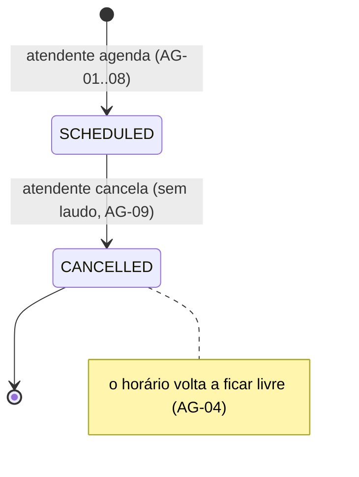
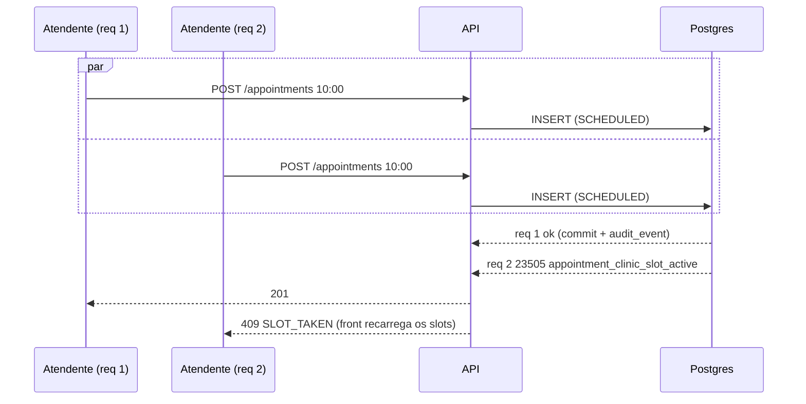
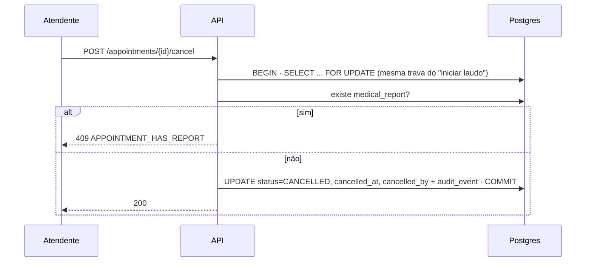

# Agendamentos

## Objetivo e escopo
A atendente seleciona paciente cadastrado, tipo de exame, data e horário; a equipe consulta e filtra por data e paciente; a atendente cancela (enunciado §4.1). Sala única **por clínica**, slots fixos de 30 min para qualquer exame.

## Atores e permissões

| Ação | Atendente | Médico | Paciente |
|---|:-:|:-:|:-:|
| Listar / filtrar / abrir | ✅ (sua clínica) | ✅ (vinculadas) | ❌ |
| Buscar paciente | ✅ | ✅ | ❌ |
| Agendar / ver slots | ✅ | ❌ | ❌ |
| Cancelar | ✅ | ❌ | ❌ |

## Regras

| ID | Regra | Enunciado |
|---|---|---|
| AG-01 | Slots de 30 min alinhados (:00/:30) → senão 422 `NOT_ALIGNED` | §4.1 |
| AG-02 | Não agendar no passado → 422 `IN_PAST` | §4.1 regra 1 |
| AG-03 | Dois agendamentos **ativos** no mesmo horário da clínica: impossível (índice único parcial) → 409 `SLOT_TAKEN` | §4.1 regra 2 |
| AG-04 | Horário de agendamento cancelado pode ser reutilizado | §4.1 regra 3 |
| AG-05 | Paciente não pode ter dois exames ativos no mesmo instante, em qualquer clínica → 409 `PATIENT_BUSY` | decisão |
| AG-06 | Expediente seg–sex, 08:00–19:00 **local da clínica** (último slot 18:30) → 422 `WEEKEND` / `OUTSIDE_BUSINESS_HOURS` | decisão |
| AG-07 | Feriados nacionais bloqueiam → 422 `HOLIDAY` (ver [calendar-holidays.md](calendar-holidays.md)) | decisão |
| AG-08 | Agendável até 31/12/2028 → 422 `BEYOND_BOOKING_WINDOW` | decisão |
| AG-09 | Cancelar só `SCHEDULED` **sem nenhum laudo** (rascunho ou publicado) → 409 `APPOINTMENT_HAS_REPORT` | §4.2 + decisão |
| AG-10 | Busca de paciente por nome (sem acento/caixa) ou CPF exato; mín. 3 caracteres (422 `SEARCH_TOO_SHORT`); máx. 20; CPF mascarado | decisão |
| AG-11 | Filtro por data usa o **dia local** da clínica convertido para intervalo UTC | §4.1 |
| AG-12 | Agendar/cancelar grava auditoria na mesma transação | decisão |

## Máquina de estados

## Sequências

**Agendamentos simultâneos (cenário obrigatório 1)**

**Cancelamento com laudo**

## Contrato da API

| Método e rota | Papel | Resposta |
|---|---|---|
| `GET /api/clinics/:clinicId/appointments?date=YYYY-MM-DD&patientId=` | staff | lista com paciente (CPF mascarado), exame, status e resumo do laudo (sem conteúdo) |
| `GET /api/clinics/:clinicId/appointments/available-slots?date=` | atendente | `{ businessDay, slots: [{ startsAt, localTime, available, reason }] }` |
| `POST /api/clinics/:clinicId/appointments` `{ patientId, examTypeId, startsAt }` | atendente | 201 + agendamento |
| `GET /api/clinics/:clinicId/appointments/:id` | staff | agendamento |
| `POST /api/clinics/:clinicId/appointments/:id/cancel` | atendente | 200 + agendamento |
| `GET /api/patients?search=` | staff | `[{ id, name, documentMasked }]` |
| `GET /api/exam-types`, `GET /api/holidays` | staff | catálogos |

## Erros
400 (validação), 401, 403 (papel/clínica/outra clínica), 404, 409 (`SLOT_TAKEN`, `PATIENT_BUSY`, `APPOINTMENT_NOT_SCHEDULED`, `APPOINTMENT_HAS_REPORT`), 422 (AG-01/02/06/07/08, `PATIENT_NOT_FOUND`, `EXAM_TYPE_NOT_FOUND`, `SEARCH_TOO_SHORT`).

## Corner cases
- **Mesmo instante em clínicas diferentes:** permitido (sala por clínica), exceto para o mesmo paciente.
- **07:30 em Rio Branco** = 09:30 em Brasília: rejeitado pela clínica de Rio Branco.
- **Slot ocupado enquanto a atendente escolhia:** 409 e o front recarrega os horários.
- **Corrida cancelar × iniciar laudo:** ambos travam a linha do agendamento (`FOR UPDATE`), então são serializados.
- **Seed com exames passados:** inseridos direto no banco (a regra AG-02 vale para a API).

## Frontend
Lista com filtros na URL (`?date=&patientId=`, validados com Zod), navegação por dia, busca de paciente com autocomplete; novo agendamento com calendário que desabilita passado, fins de semana, feriados e após 31/12/2028, e chips com os horários livres no fuso da clínica.

## Rastreabilidade

| Regra | Teste |
|---|---|
| AG-01, AG-02, AG-06, AG-07, AG-08 | `booking-rules.spec.ts` (unitário) e `scheduling.e2e-spec.ts` › rejeita fim de semana, feriado, fora do expediente e após 31/12/2028 |
| AG-02 | `scheduling.e2e-spec.ts` › [obrigatório 5] |
| AG-03 | `scheduling.e2e-spec.ts` › [obrigatório 1] (8 requisições simultâneas) |
| AG-04 | `scheduling.e2e-spec.ts` › permite reutilizar o horário de um cancelado |
| AG-05 | `scheduling.e2e-spec.ts` › mesmo paciente no mesmo horário em outra clínica → 409 |
| AG-09 | `medical-reports.e2e-spec.ts` › agendamento com laudo não pode ser cancelado |
| AG-10 | `scheduling.e2e-spec.ts` › busca por nome sem acento e por CPF; `misc.spec.ts` (máscara) |
| AG-11 | `booking-rules.spec.ts` › intervalo UTC por fuso; `scheduling.e2e-spec.ts` › filtra por data e paciente |
| AG-12 | `scheduling.e2e-spec.ts` › auditoria na mesma transação; agendamento rejeitado não gera evento |

## Limitações
Sem remarcação (cancelar e agendar de novo); sem duração por tipo de exame; listagem limitada a 500 itens por consulta (sem paginação).
