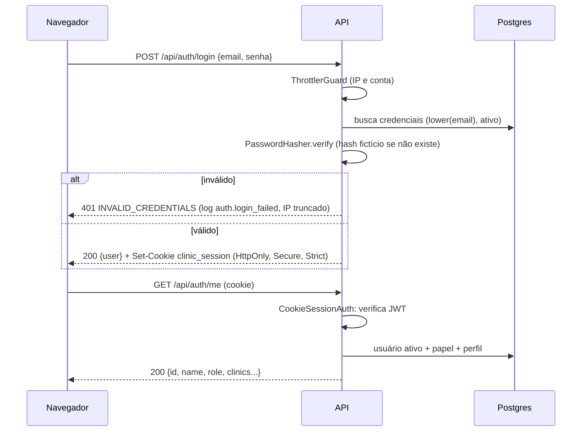

# Autenticação e autorização

## Objetivo e escopo
Login por e-mail/senha com sessão em cookie HttpOnly, perfis (Atendente, Médico, Paciente) e autorização verificada **sempre no backend**, inclusive em chamadas diretas à API (enunciado §3). Fora do escopo: cadastro de usuários, recuperação de senha, MFA.

## Atores e permissões

| Ação | Atendente | Médico | Paciente | Serviço de integração |
|---|:-:|:-:|:-:|:-:|
| `POST /auth/login`, `/auth/logout` | ✅ | ✅ | ✅ | — |
| `GET /auth/me` | ✅ | ✅ | ✅ | ❌ (401) |
| Rotas `/clinics/:clinicId/...` | conforme papel | conforme papel | ❌ (403) | ❌ (401) |
| Rotas `/me/...` do paciente | ❌ (403) | ❌ (403) | ✅ | ❌ (401) |
| `GET /fhir/medical-reports/:id` | ❌ (401) | ❌ (401) | ❌ (401) | ✅ |

## Regras

| ID | Regra | Origem |
|---|---|---|
| AU-01 | Login devolve o JWT **somente** em cookie `HttpOnly; Secure; SameSite=Strict; Path=/; Max-Age=3600`; nunca no corpo | Plano §8 |
| AU-02 | JWT HS256 (`AUTH_SECRET` ≥ 32 bytes), claims `sub`, `iat`, `exp`, `iss`, `aud`, `jti`. Expira em 1 h, sem refresh | Plano §8 |
| AU-03 | O papel **não** está no token: o usuário é carregado do banco a cada requisição; inativo → 401 | Plano §8 |
| AU-04 | E-mail inexistente e senha errada respondem igual (mesmo status, corpo e tempo — hash fictício) | Boa prática |
| AU-05 | 10 tentativas de login/minuto por IP **e** por conta → 429 `TOO_MANY_ATTEMPTS` | Plano §8 |
| AU-06 | Deny-by-default: rota sem `@Can()`/`@Public()` é negada | `@nestjs/authorization` |
| AU-07 | 401 = sem credencial/inválida (front volta ao login com `?redirect=`); 403 = sem permissão (front mostra "acesso negado" e mantém a sessão) | Plano §8 |
| AU-08 | CSRF: escrita só da mesma origem (`Sec-Fetch-Site`/`Origin` × `Host`) + `SameSite=Strict` | Plano §8 |
| AU-09 | Token de serviço só é aceito na rota FHIR; em qualquer outra é ignorado (→ 401) | Plano §7.5 |

## Sequência — login e chamada autenticada

## Contrato da API
- `POST /api/auth/login` `{ email, password }` → `200 { user }` + `Set-Cookie`. Erros: 400, 401 `INVALID_CREDENTIALS`, 429.
- `POST /api/auth/logout` → `204` + cookie expirado (público: funciona com sessão expirada).
- `GET /api/auth/me` → `{ id, name, email, role, patientId, doctorId, clinics[] }`.

## Corner cases
- **Token válido, usuário desativado** → 401 na próxima requisição (AU-03).
- **Header `Authorization` com JWT de usuário** em qualquer rota → ignorado/401: sessões só valem por cookie.
- **Cookie adulterado/expirado** → 401 (não cai para outro provider).
- **POST de outro site com o cookie** → 403 pela proteção CSRF antes de chegar ao handler.
- **curl e cookie `Secure` em HTTP:** navegadores aceitam em `*.localhost`; o curl não reenvia do *cookie jar* — README mostra como enviar o cookie explicitamente.

## Segurança
`PasswordHasher` (scrypt) com comparação em tempo constante; segredo de sessão e de serviço distintos (a aplicação recusa iniciar se forem iguais ou curtos); o token nunca chega ao JavaScript.

## Rastreabilidade

| Regra | Teste |
|---|---|
| AU-01 | `auth-audit.e2e-spec.ts` › login pela rota real: cookie HttpOnly/SameSite=Strict/Secure, sem token no corpo |
| AU-03 | `auth-audit.e2e-spec.ts` › usuário desativado perde o acesso na hora |
| AU-04 | `auth-audit.e2e-spec.ts` › senha errada e e-mail inexistente respondem igual |
| AU-05 | `auth-audit.e2e-spec.ts` › 11ª tentativa por conta / por IP → 429 |
| AU-07 | `scheduling.e2e-spec.ts` › paciente não acessa rotas da clínica (403) e sem sessão é 401 |
| AU-09 | `fhir.e2e-spec.ts` › token de serviço não vale em nenhum outro endpoint |
| AU-08 | verificado manualmente (POST cross-site → 403) |

## Limitações e evoluções
Sem revogação de token antes de expirar (stateless); sem MFA; sem recuperação de senha. Evolução: sessões no servidor (`SessionCookieProvider` com store no Postgres).
