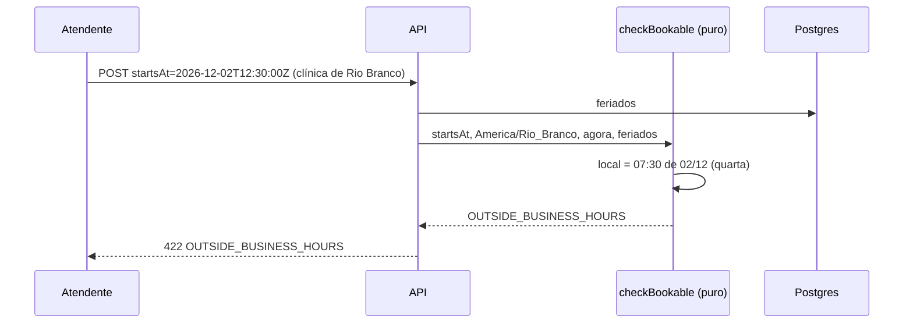

# Calendário: fusos, expediente, slots e feriados

## Objetivo e escopo
Definir quando um exame pode ser agendado, de forma consistente entre clínicas em fusos diferentes, e documentar o fuso adotado (enunciado §4.1, regra 4).

## Regras

| ID | Regra |
|---|---|
| CA-01 | Persistência em UTC (`timestamptz`); API em ISO 8601 UTC |
| CA-02 | Cada clínica tem um fuso entre `America/Sao_Paulo` (UTC-3), `America/Manaus` (UTC-4) e `America/Rio_Branco` (UTC-5) — `CHECK` no banco |
| CA-03 | Expediente, fim de semana, feriado e "dia" dos filtros são avaliados **no horário local da clínica** |
| CA-04 | Slots de 30 min de 08:00 a 18:30 locais (22 por dia), seg–sex |
| CA-05 | Feriados nacionais 2026–2028 (lista estática, inclui Carnaval e Corpus Christi) bloqueiam o dia |
| CA-06 | Janela máxima: 31/12/2028 |
| CA-07 | A interface exibe horários no fuso da clínica, com a indicação ("horário do Acre"), para todos os perfis |
| CA-08 | Premissa: sem horário de verão no Brasil desde 2019 |

Ordem de avaliação em `checkBookable` (função pura, `appointments/booking-rules.ts`): `NOT_ALIGNED` → `IN_PAST` → `BEYOND_BOOKING_WINDOW` → `WEEKEND` → `HOLIDAY` → `OUTSIDE_BUSINESS_HOURS`.

## Feriados cadastrados
Fixos (todo ano): 01/01, 21/04, 01/05, 07/09, 12/10, 02/11, 15/11, 20/11, 25/12.

| Ano | Carnaval | Sexta-feira Santa | Corpus Christi |
|---|---|---|---|
| 2026 | 16–17/02 | 03/04 | 04/06 |
| 2027 | 08–09/02 | 26/03 | 27/05 |
| 2028 | 28–29/02 | 14/04 | 15/06 |

## Sequência — validação de um horário

## Corner cases
- **Mesmo instante, fusos diferentes:** 10:00 em SP = 08:00 em Rio Branco (válido nas duas) = 09:00 em Manaus.
- **Virada de dia:** 18:30 de sexta em Manaus = 22:30 UTC (ainda sexta) — o fim de semana é avaliado no local.
- **Filtro "dia 02/12" em Manaus:** intervalo UTC `[02/12 04:00, 03/12 04:00)`.
- **Navegador em outro fuso:** a exibição usa sempre o fuso da clínica (`Intl.DateTimeFormat` com `timeZone`), verificado com o navegador em Lisboa.
- **Banco:** a conexão do app usa `timezone=UTC`; o `CHECK` de alinhamento usa época Unix, independente do fuso da sessão.

## Rastreabilidade

| Regra | Teste |
|---|---|
| CA-03, CA-04 | `booking-rules.spec.ts` › avalia o expediente no horário LOCAL (bordas 08:00, 18:30, 19:00); 22 slots |
| CA-05 | `booking-rules.spec.ts` › feriado nacional, Carnaval e Corpus Christi |
| CA-06 | `booking-rules.spec.ts` › após 31/12/2028 |
| CA-01, CA-03 | `booking-rules.spec.ts` › intervalo UTC correto por fuso; virada de dia em Manaus |
| Seed só em dias úteis | `seed.e2e-spec.ts` › véspera de Natal, sexta antes do Carnaval e virada de dia entre fusos: os "3 próximos dias úteis" pulam fins de semana e feriados, e nenhum agendamento (passado ou futuro) cai neles |

## Limitações e evoluções
Lista de feriados estática (atualização anual); só feriados nacionais (sem estaduais/municipais nem recesso da clínica — a tabela `holiday` já comporta essas datas).
