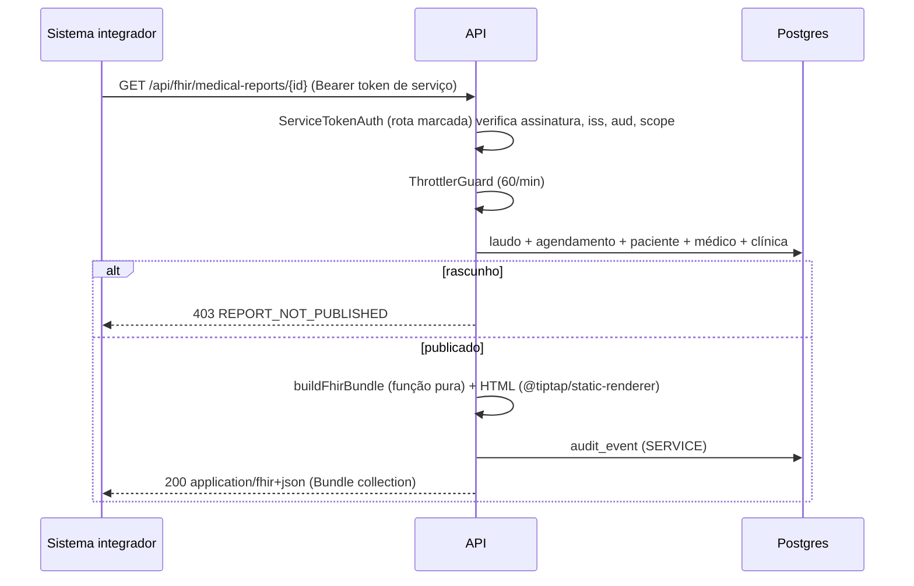

# Exportação FHIR (bônus)

## Objetivo e escopo
Um único endpoint, **exclusivo do serviço de integração**, exporta um laudo publicado como `Bundle` FHIR R4 (4.0.1). Sem opção no frontend.

## Regras

| ID | Regra |
|---|---|
| FH-01 | `GET /api/fhir/medical-reports/:id` aceita **somente** `Authorization: Bearer <token de serviço>`; sessões de usuário → 401 |
| FH-02 | Token de serviço fixo: JWT HS256 com segredo próprio (`SERVICE_TOKEN_SECRET`), `iss=clinica-exames`, `aud=fhir-export`, `sub=fhir-export-service`, `scope=fhir:read`, **sem expiração** |
| FH-03 | O token de serviço é ignorado em qualquer outra rota (→ 401) |
| FH-04 | Só laudos publicados (rascunho → 403 `REPORT_NOT_PUBLISHED`), de qualquer clínica |
| FH-05 | Limite de 60 chamadas/minuto |
| FH-06 | Auditoria `medical_report.exported_fhir` com `actor_type = SERVICE` |
| FH-07 | Revogação: trocar `SERVICE_TOKEN_SECRET` (não afeta sessões de usuários) |

## Mapeamento

| Recurso | Campos |
|---|---|
| `DiagnosticReport` | `status=final`; `category` = `RAD` (HL7 v2-0074); `code` = tipo do exame (`text` + LOINC quando confirmado); `subject`; `effectiveDateTime` = horário do exame com o offset do fuso da clínica; `issued` = publicação; `performer` = clínica; `resultsInterpreter` = médico; `conclusion` = texto puro; `presentedForm` = HTML (base64) com título, corpo e assinatura; `identifier` = `urn:uuid:<id>` |
| `Patient` | nome, data de nascimento, CPF (`identifier`, sistema configurável `FHIR_CPF_SYSTEM`) |
| `Practitioner` | nome e CRM/UF usado na publicação (`identifier` e `qualification`, sistema `FHIR_CRM_SYSTEM/<UF>`) |
| `Organization` | nome, cidade/UF |

LOINC confirmados: Ultrassonografia `25061-3` (*US Unspecified body region*), Ressonância Magnética `25056-3` (*MR Unspecified body region*). Raio-X sem código confirmado → `code` só com `text` (o FHIR permite).

## Sequência



## Uso

```bash
make fhir                              # gera o token, escolhe o laudo publicado mais recente e chama a API
make fhir PACIENTE=joao@mail.com       # ou o mais recente de um paciente
make fhir LAUDO=<medical_report_id>    # ou um laudo específico

# manualmente
TOKEN=$(make -s service-token)
curl -H "Authorization: Bearer $TOKEN" http://clinica.localhost/api/fhir/medical-reports/<id>
```

Exemplo resumido de resposta:

```json
{ "resourceType": "Bundle", "type": "collection", "entry": [
  { "fullUrl": "urn:uuid:…", "resource": { "resourceType": "DiagnosticReport", "status": "final",
      "code": { "coding": [{ "system": "http://loinc.org", "code": "25056-3" }], "text": "Ressonância Magnética" },
      "effectiveDateTime": "2026-11-19T10:00:00-04:00", "issued": "2026-11-20T15:00:00.000Z",
      "presentedForm": [{ "contentType": "text/html", "data": "PCFkb2N0eXBl…" }] } },
  { "resource": { "resourceType": "Patient", "identifier": [{ "system": "https://saude.gov.br/fhir/sid/cpf", "value": "…" }] } },
  { "resource": { "resourceType": "Practitioner", "identifier": [{ "system": "…/crm/AM", "value": "112233" }] } },
  { "resource": { "resourceType": "Organization", "name": "Clínica Demo Manaus" } } ] }
```

## Rastreabilidade

| Regra | Teste |
|---|---|
| Mapeamento e validade R4 | `fhir.mapper.spec.ts` (inclui `validateResource` do Medplum com as definições oficiais R4) |
| FH-01 | `fhir.e2e-spec.ts` › sessão de usuário não é aceita (401); JWT de usuário no header → 401 |
| FH-02 | `fhir.e2e-spec.ts` › token com outro segredo ou sem scope → 401 |
| FH-03 | `fhir.e2e-spec.ts` › token de serviço não vale em nenhum outro endpoint |
| FH-04 | `fhir.e2e-spec.ts` › rascunho → 403; inexistente → 404 |
| FH-06 | `fhir.e2e-spec.ts` › auditoria `actor_type=SERVICE` |

## Limitações
FHIR R4 base (sem perfis BR Core/RNDS; não há URI nacional confirmada para CRM); um único cliente integrador com acesso a todas as clínicas; token sem expiração; o compartilhamento de dados com terceiros exige base legal (LGPD), fora do escopo técnico.
