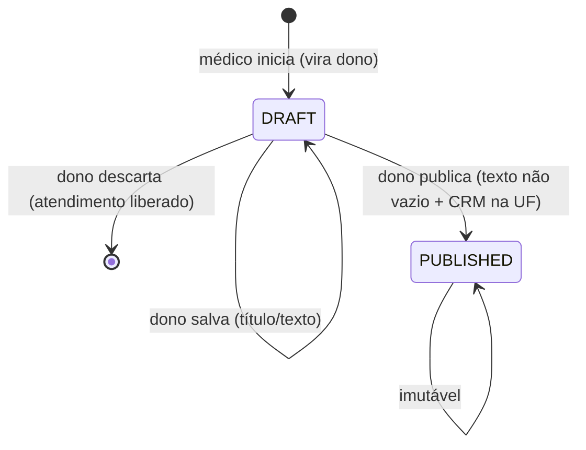
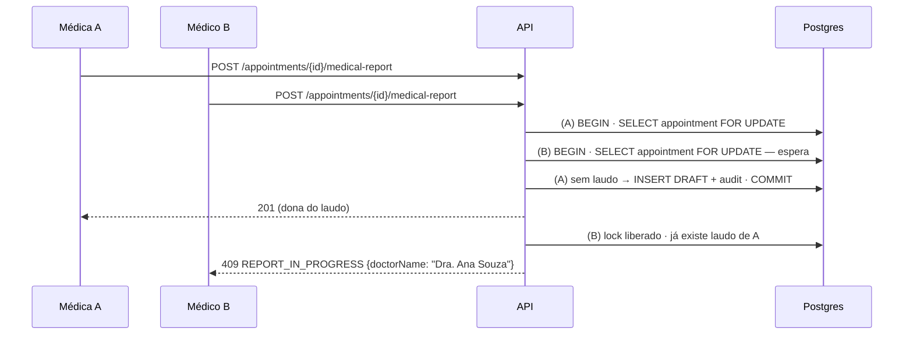
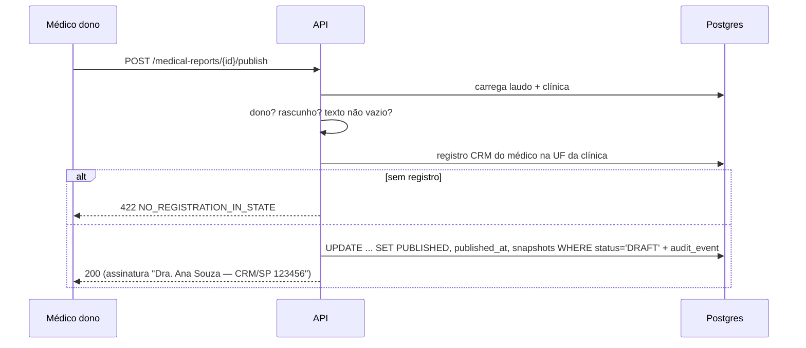

# Laudos (MedicalReport)

## Objetivo e escopo
O médico abre um agendamento, cria o laudo (título, texto e profissional responsável), salva como rascunho e depois publica (enunciado §4.2). Fora do escopo: PDF, anexos, assinatura digital, validação clínica.

## Atores e permissões

| Ação | Atendente | Médico dono | Outro médico da clínica | Paciente |
|---|:-:|:-:|:-:|:-:|
| Iniciar laudo | ❌ | ✅ (se vinculado à clínica) | ✅ se ninguém iniciou | ❌ |
| Ver/editar/descartar rascunho | ❌ (só status) | ✅ | ❌ (403) | ❌ (403) |
| Publicar | ❌ | ✅ (com CRM na UF) | ❌ | ❌ |
| Ver publicado | ✅ | ✅ | ✅ | ✅ (só o próprio) |

## Regras

| ID | Regra | Enunciado |
|---|---|---|
| LA-01 | Um laudo por agendamento (`UNIQUE appointment_id`) | §4.2 |
| LA-02 | "Iniciar laudo" cria um rascunho vazio e torna o médico **dono** — o rascunho é a trava do atendimento; outro médico recebe 409 `REPORT_IN_PROGRESS` com o nome do responsável | decisão |
| LA-03 | Só o dono edita, publica ou descarta (outro → 403 `REPORT_NOT_OWNER`) | §4.2 + decisão |
| LA-04 | Rascunho visível só para o dono; equipe vê status e responsável | §4.2 |
| LA-05 | Publicado não pode ser editado (409 `REPORT_PUBLISHED`) | §4.2 |
| LA-06 | Cancelado não recebe laudo (409 `APPOINTMENT_CANCELLED`) | §4.2 |
| LA-07 | Com laudo (rascunho ou publicado) não pode ser cancelado (409 `APPOINTMENT_HAS_REPORT`) | §4.2 + decisão |
| LA-08 | Registra `published_at` | §4.2 |
| LA-09 | Título = tipo do exame (fixo, montado no backend) + complemento opcional | decisão |
| LA-10 | Texto em JSON do Tiptap validado por lista fechada (negrito, itálico, sublinhado, H2/H3, listas, alinhamento, quebra de linha); qualquer outro nó/marca/atributo → 422 `INVALID_REPORT_BODY`; máx. 100 KB, medidos como o banco mede no CHECK (`octet_length(body::text)` do jsonb), então acima disso → 422, nunca 500 | decisão |
| LA-11 | Não publica laudo vazio → 422 `EMPTY_REPORT_BODY` | decisão |
| LA-12 | Publicar exige CRM do médico **na UF da clínica** → senão 422 `NO_REGISTRATION_IN_STATE`; grava `registration_id`, `professional_name` e `professional_registration` (assinatura imutável) | §4.2 (profissional responsável) + decisão |
| LA-13 | Publicação atômica: `UPDATE ... WHERE status = 'DRAFT' AND doctor_id = dono` | decisão |
| LA-14 | O dono pode descartar o rascunho; o atendimento fica livre (e pode voltar a ser cancelado) | decisão |
| LA-15 | Criar, salvar, descartar, publicar e visualizar geram auditoria; conteúdo nunca vai para logs | decisão |

## Máquina de estados



## Sequências

**Dois médicos iniciando ao mesmo tempo**



**Publicação**



## Contrato da API

| Método e rota | Papel | Corpo / resposta |
|---|---|---|
| `POST /api/clinics/:clinicId/appointments/:id/medical-report` | médico | 201 rascunho vazio |
| `GET /api/clinics/:clinicId/medical-reports/:id` | staff | laudo (rascunho só para o dono, com `signaturePreview`) |
| `PUT /api/clinics/:clinicId/medical-reports/:id` | médico dono | `{ titleComplement?, body }` → laudo |
| `DELETE /api/clinics/:clinicId/medical-reports/:id` | médico dono | 204 |
| `POST /api/clinics/:clinicId/medical-reports/:id/publish` | médico dono | 200 laudo publicado |

Formato do corpo (exemplo):

```json
{ "type": "doc", "content": [
  { "type": "heading", "attrs": { "level": 2, "textAlign": null }, "content": [{ "type": "text", "text": "Conclusão" }] },
  { "type": "paragraph", "attrs": { "textAlign": "justify" },
    "content": [{ "type": "text", "text": "Sem alterações.", "marks": [{ "type": "bold" }] }] } ] }
```

## Erros
403 (`REPORT_NOT_OWNER`, `REPORT_DRAFT_RESTRICTED`, `REPORT_OTHER_CLINIC`, papel), 404, 409 (`REPORT_IN_PROGRESS`, `REPORT_EXISTS`, `REPORT_PUBLISHED`, `APPOINTMENT_CANCELLED`), 422 (`INVALID_REPORT_BODY`, `EMPTY_REPORT_BODY`, `NO_REGISTRATION_IN_STATE`).

## Frontend
Editor Tiptap (`@mantine/tiptap`) com a mesma lista fechada; título com o tipo do exame fixo + complemento; pré-visualização da assinatura (ou aviso de CRM ausente na UF); salvar, descartar (confirmação) e publicar (modal com a **pré-visualização final** e o aviso de que não poderá ser editado); aviso ao sair com alterações não salvas. Publicado: só leitura, igual à visão do paciente.

## Corner cases
- Cliente envia `title` próprio → ignorado; o título sempre contém o tipo do exame.
- JSON com imagem/link/cor/HTML cru → 422.
- Médico com CRM/SP e CRM/MG publicando em BH → assina com CRM/MG.
- Mesmo médico em duas abas → vale a última gravação (sem controle de versão, decisão).
- Médico desvinculado da clínica com rascunho aberto → atendimento preso (limitação).

## Rastreabilidade

| Regra | Teste |
|---|---|
| LA-02 | `medical-reports.e2e-spec.ts` › dois médicos iniciando ao mesmo tempo: só um consegue |
| LA-03, LA-04, LA-14 | `medical-reports.e2e-spec.ts` › o dono é o único que edita, publica, descarta e vê o conteúdo |
| LA-05, LA-06, LA-07 | `medical-reports.e2e-spec.ts` › publicado não pode ser editado; com laudo não cancela; cancelado não recebe laudo |
| LA-09 | `medical-reports.e2e-spec.ts` › título sempre contém o tipo do exame; `report-body.spec.ts` |
| LA-10, LA-11 | `report-body.spec.ts` (lista fechada, JSON real do editor), `report-size.spec.ts` (limite de 100 KB no formato do banco, caractere nulo) e `medical-reports.e2e-spec.ts` › valida o corpo e não publica vazio; › mede o tamanho do corpo como o CHECK do banco; › jsonbTextBytes bate com o Postgres; › caractere nulo → 422 |
| LA-12 | `medical-reports.e2e-spec.ts` › publicação exige CRM na UF da clínica e grava o registro correto |
| LA-08 | `medical-reports.e2e-spec.ts` › [obrigatório 4] (`publishedAt`) |
| LA-15 | `fhir.e2e-spec.ts` / `scheduling.e2e-spec.ts` (auditoria); `misc.spec.ts` (redação) |

## Limitações e evoluções
Sem versão/histórico do rascunho; sem transferência de laudo entre médicos; sem PDF nem assinatura digital (fora do escopo).
