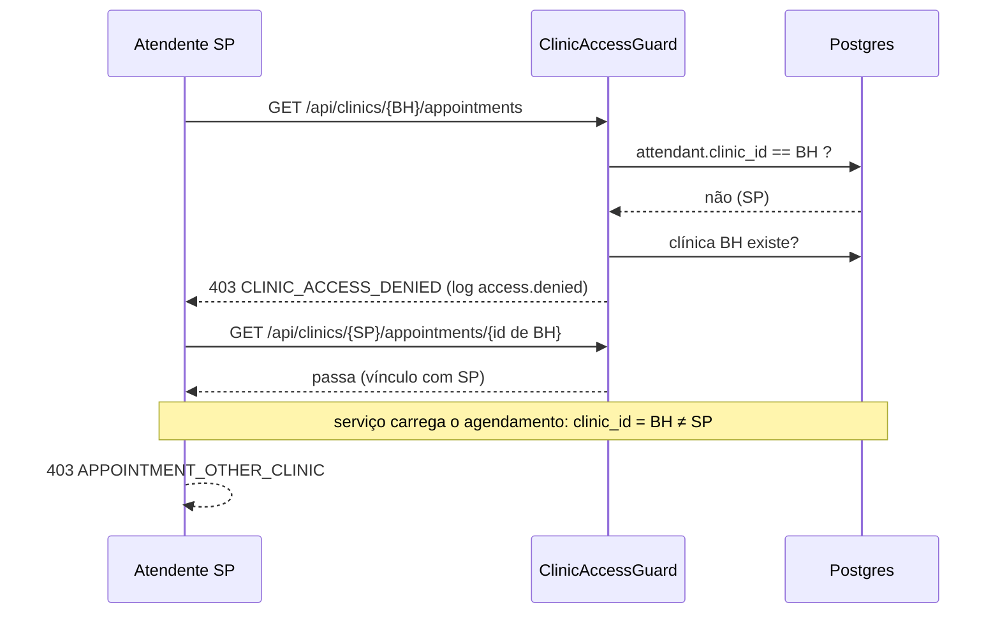

# Multi-tenant (clínicas)

## Objetivo e escopo
Quatro clínicas compartilham o sistema com isolamento de dados: cada atendente e médico só enxerga as clínicas a que está vinculado; o paciente é global. Clínicas e vínculos são cadastrados via seed (sem tela de administração).

| Clínica | UF | Fuso |
|---|---|---|
| Clínica Demo São Paulo | SP | America/Sao_Paulo |
| Clínica Demo Belo Horizonte | MG | America/Sao_Paulo |
| Clínica Demo Manaus | AM | America/Manaus |
| Clínica Demo Rio Branco | AC | America/Rio_Branco |

## Regras

| ID | Regra |
|---|---|
| MT-01 | Atendente pertence a **exatamente uma** clínica (`attendant.clinic_id NOT NULL`, `user_id UNIQUE`) |
| MT-02 | Médico atua em N clínicas (`doctor_clinic`) |
| MT-03 | Paciente é global; vê seus dados de todas as clínicas |
| MT-04 | Rotas de clínica levam o id na URL (`/clinics/:clinicId/...`); o `ClinicAccessGuard` confere o vínculo **no banco a cada requisição** |
| MT-05 | Sem vínculo → 403 `CLINIC_ACCESS_DENIED`; clínica inexistente/id inválido → 404 |
| MT-06 | Recurso de outra clínica acessado pela URL da sua → 403 (`APPOINTMENT_OTHER_CLINIC`, `REPORT_OTHER_CLINIC`) |
| MT-07 | Todas as consultas de domínio filtram por `clinic_id` da clínica validada |
| MT-08 | Catálogos globais: tipos de exame, feriados, conselhos profissionais |

## Sequência — acesso negado a outra clínica

## Frontend
Atendente cai direto na sua clínica; médico com mais de uma escolhe em `/select-clinic` e troca pelo seletor do cabeçalho. O cabeçalho mostra a clínica e o fuso.

## Corner cases
- Vínculo removido no meio da sessão → próximo request já é 403 (MT-04, sem cache no token).
- Médico desvinculado com rascunho aberto → o atendimento fica preso (limitação documentada).
- Paciente agendado em duas clínicas no mesmo instante → 409 `PATIENT_BUSY` (ver [appointments.md](appointments.md)).

## Rastreabilidade

| Regra | Teste |
|---|---|
| MT-04, MT-05, MT-06 | `scheduling.e2e-spec.ts` › atendente da clínica A não lista, não abre e não cancela agendamento da clínica B |
| MT-02 | `scheduling.e2e-spec.ts` › médico vê só as clínicas vinculadas; `auth-audit.e2e-spec.ts` › clínicas no login |
| MT-03 | `medical-reports.e2e-spec.ts` › paciente vê agendamentos de todas as suas clínicas |
| MT-06 (laudo) | `medical-reports.e2e-spec.ts` › médico sem vínculo não cria laudo |

## Limitações e evoluções
Isolamento garantido na aplicação; **Row Level Security** do Postgres seria uma segunda camada. Sem administração de clínicas/vínculos (seed).
