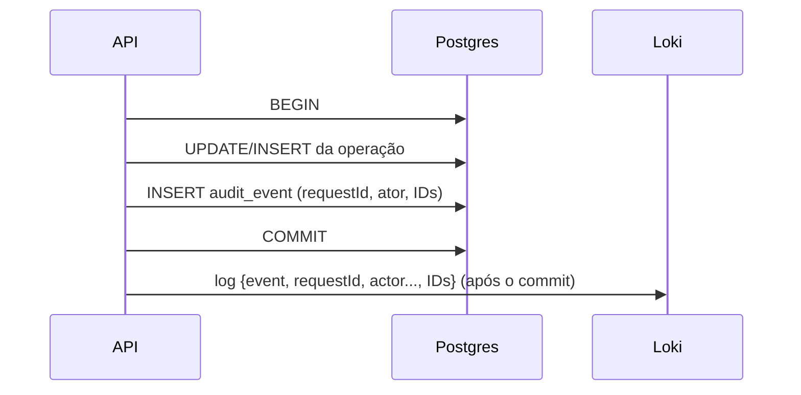

# Observabilidade

## Objetivo e escopo
Logs estruturados pesquisáveis por paciente e por usuário, trilha de auditoria que "conta a história" de um paciente, e dashboards operacionais. Stack: **Grafana 13 + Loki 3**, no docker compose.

## Componentes
- **Logs:** `nestjs-pino` (JSON). O backend envia direto ao Loki via `pino-loki` (lote assíncrono; falha do Loki não derruba a API) e também escreve no stdout (`docker compose logs backend`).
- **Auditoria:** tabela `audit_event`, gravada **na mesma transação** da operação (operação que falha não gera evento); o log do evento é emitido só após o commit. Append-only: `clinic_app` só tem `INSERT`/`SELECT`.
- **Grafana:** `http://grafana.clinica.localhost`, login obrigatório, datasources (Postgres via `grafana_ro` e Loki) e dashboards provisionados por arquivo (`docker/grafana/`; JSON gerado por `docker/grafana/generator/build_dashboards.py`).
- **Loki:** só na rede interna; retenção de 7 dias. A auditoria não tem expurgo (dado de saúde exige guarda longa).
- **Health check:** `GET /api/health` (liveness, não toca no banco — healthcheck do Docker) e `GET /api/health/ready` (readiness: `SELECT 1` com timeout de 2 s, ajustável por `HEALTH_DB_TIMEOUT_MS`; `503 NOT_READY` com `details.database = "down"`). Ambos públicos e fora dos logs de requisição.
- **Sonda de disponibilidade (`uptime`):** container separado (`docker/uptime/probe.mjs`, Node sem dependências) que, a cada 15 s (timeout 5 s), chama o `/ready` da API e o `/statistics` do Orthanc (PACS de demonstração) e envia ao Loki `{app="uptime", target="clinic-api"}` com `up` (200), `apiUp` (a API respondeu), `dbUp` (1/0, ou −1 quando a API não respondeu), `httpStatus` e `latencyMs`, e `{app="uptime", target="pacs"}` com `up`, `studies` (estudos no PACS), `httpStatus` e `latencyMs`. Black-box: a queda do backend é registrada de fora dele. No stdout, só as transições de estado.
- **Correlação:** o nginx gera `X-Request-Id`; ele aparece em todos os logs, na `audit_event` e no header da resposta.

## Contrato dos logs
- Labels do Loki (baixa cardinalidade): `app="clinic-api"`, `env`, `level`. IDs ficam no JSON.
- Campos: `event`, `requestId`, `actorType`, `actorId`, `actorRole`, `authMethod`, `clinicId`, `patientId`, `appointmentId`, `medicalReportId`, `doctorId`, `code`; nos logs de requisição: `method`, `route` (padrão, ex. `/api/clinics/:clinicId/appointments`), `statusCode`, `responseTimeMs`.
- **LGPD:** somente IDs. Nome, e-mail, CPF, senha, cookie/token, título e texto de laudo são removidos na origem (`redact` do pino), coberto por teste. IP só no login com falha, com o último octeto zerado.

| Evento | Destino |
|---|---|
| `appointment.scheduled`, `appointment.cancelled` | log + auditoria |
| `medical_report.draft_created`, `.draft_updated`, `.draft_discarded`, `.published`, `.viewed`, `.exported_fhir` | log + auditoria |
| `appointment.conflict` (409), `access.denied` (403) | só log |
| `auth.login_succeeded`, `auth.login_failed`, `auth.logout` | só log |
| `http.request` | só log (uma linha por requisição) |

## Sequência — evento auditado



## Dashboards (10 visualizações + investigação)

| Dashboard | Visualizações |
|---|---|
| **Operação** (Postgres, filtros clínica + período) | 1 KPIs (criados, exames no período, laudos publicados, taxa de cancelamento) · 2 agendamentos criados/dia por clínica · 3 exames por tipo empilhado por clínica · 4 ranking de médicos por laudos publicados · 5 cancelamentos/dia · 6 ocupação dia da semana × horário (mapa de calor) · 7 tempo até a publicação (média e p90) |
| **Saúde da API** (Loki, atualiza a cada 30 s) | 0 disponibilidade: API, banco e PACS (Orthanc) UP/DOWN (última sondagem, 60 s; sem sondagem = SEM DADOS), estudos no PACS, % disponível no período e latência (API e PACS) e histórico UP/DOWN · 8 respostas por status e erros por rota · 9 acessos negados e logins com falha (série + detalhe) · 10 latência p95 por rota |
| **Linha do tempo do paciente** | auditoria por `patientId` + logs do paciente |
| **Atividade por usuário** | auditoria por `userId`, volume por evento e logs |

Definições: "criados" por `created_at`; "exames no período" e tipos por `starts_at`; laudos só publicados, por `published_at`; cancelamentos por `cancelled_at`; dias agrupados no fuso de cada clínica.

## Consultas de referência

```logql
# Tudo o que um usuário fez
{app="clinic-api"} |= `$userId` | json | actorId = `$userId`
  | line_format `{{.actorRole}} {{.event}} {{.method}} {{.route}} {{.statusCode}} | clinic={{.clinicId}} patient={{.patientId}} req={{.requestId}}`

# História do paciente nos logs (inclui ações da equipe sobre ele)
{app="clinic-api"} |= `$patientId` | json | patientId = `$patientId` and event != ""
```

```logql
# Disponibilidade (stat e % no período)
last_over_time({app="uptime", target="clinic-api"} | json | unwrap apiUp [1m]) by (target)
avg_over_time({app="uptime", target="clinic-api"} | json | unwrap up [$__range]) by (target)
```

```sql
-- Linha do tempo do paciente (auditoria)
SELECT created_at, event, actor_type, actor_role, actor_id, clinic_id, appointment_id, medical_report_id, request_id
FROM audit_event WHERE patient_id = '<id>' ORDER BY created_at;
```

Sem Grafana, a mesma linha do tempo sai no terminal: `make db-historico PACIENTE=joao@mail.com` (e `make db-auditoria`).

## Rastreabilidade

| Regra | Teste |
|---|---|
| Auditoria na mesma transação | `scheduling.e2e-spec.ts` › cria agendamento e registra auditoria; agendamento rejeitado não gera evento |
| Append-only | `auth-audit.e2e-spec.ts` › `clinic_app` não consegue alterar nem apagar a trilha |
| Redação LGPD | `misc.spec.ts` › remove nome, e-mail, CPF, senha, conteúdo do laudo e cookies |
| Ator de serviço | `fhir.e2e-spec.ts` › auditoria registra `actorType=SERVICE` |
| Health check | `health.controller.spec.ts` (liveness sem banco; banco com erro ou travado → 503) e `health.e2e-spec.ts` (rotas públicas, ping real) |
| Sonda + painéis UP/DOWN | verificados manualmente: `docker compose stop backend` → API DOWN / banco DESCONHECIDO; `stop postgres` → API UP / banco DOWN; `stop orthanc` → PACS DOWN; volta a UP ao religar |
| Dashboards | verificados manualmente: datasources OK, consultas SQL e LogQL executadas no Grafana |

## Limitações
O Grafana lê as tabelas operacionais diretamente (inclui dados pessoais — decisão por simplicidade; o ideal seria base analítica apartada). Sem métricas Prometheus (saúde da API derivada dos logs e da sonda). A sonda roda no mesmo host: se o host inteiro cair, os painéis mostram SEM DADOS em vez de DOWN; a disponibilidade no período só considera intervalos com sondagem. Sem alertas configurados. Retenção curta do Loki (7 dias) — a auditoria é a fonte de longo prazo.
