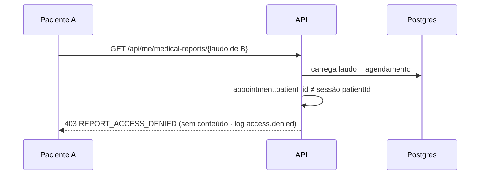

# Portal do paciente

## Objetivo e escopo
O paciente consulta os próprios agendamentos (tipo, data, situação), identifica quais têm laudo **publicado** e lê seus laudos; nunca acessa dados de outro paciente nem rascunhos (enunciado §4.3).

## Regras

| ID | Regra | Enunciado |
|---|---|---|
| PP-01 | Tudo é filtrado pelo `patientId` **da sessão**, nunca por parâmetro | §4.3 |
| PP-02 | Lista traz exame, data/hora (no fuso da clínica), clínica, situação e `hasPublishedMedicalReport` | §4.3 |
| PP-03 | Rascunhos não aparecem: nem título, nem texto, nem id (`medicalReportId` só se publicado) | §4.3 |
| PP-04 | Laudo de outro paciente → 403 `REPORT_ACCESS_DENIED` | §4.3 / teste 2 |
| PP-05 | Laudo próprio em rascunho → 403 `REPORT_NOT_PUBLISHED`, sem conteúdo | teste 3 |
| PP-06 | Paciente é global: vê agendamentos de todas as clínicas | decisão |
| PP-07 | Leitura de laudo gera auditoria `medical_report.viewed` | decisão |
| PP-08 | **Extra de demonstração:** o laudo publicado traz `imageViewerUrl` e a tela mostra **Visualizar imagens**, que abre o Stone Web Viewer. Só no laudo do próprio paciente (PP-04, PP-05), nunca para cancelado e nunca na lista de agendamentos. **Limitação aceita por simplicidade:** o PACS de demonstração é aberto: quem chega ao host dele (`pacs.clinica.localhost`), inclusive um paciente que abriu o link e apagou o fim da URL, vê **todos os estudos de todos os pacientes** e pode alterá-los. | decisão (extra) |

## Sequência — laudo de outro paciente

## Contrato da API
- `GET /api/me/appointments` → `[{ id, startsAt, status, examType, clinic{ name, timezone, timezoneLabel }, hasPublishedMedicalReport, medicalReportId, publishedAt }]`
- `GET /api/me/medical-reports/:id` → laudo publicado: título, corpo, assinatura (nome + CRM), `publishedAt`, clínica, horário do exame e `imageViewerUrl` (link das imagens no PACS de demonstração, ou `null`).

## Frontend
`/patient/appointments` (cartões com o selo "Laudo disponível" e o horário no fuso da clínica) e `/patient/medical-reports/$medicalReportId` (leitura com o mesmo componente do editor em modo somente leitura e a assinatura no rodapé; botão **Visualizar imagens** quando o exame tem imagem no PACS, PP-08). A lista recarrega ao voltar para a aba, para mostrar um laudo recém-publicado.

## Rastreabilidade

| Regra | Teste |
|---|---|
| PP-04 | `medical-reports.e2e-spec.ts` › [obrigatório 2] |
| PP-03, PP-05 | `medical-reports.e2e-spec.ts` › [obrigatório 3] |
| PP-02 | `medical-reports.e2e-spec.ts` › [obrigatório 4] |
| PP-06 | `medical-reports.e2e-spec.ts` › paciente vê agendamentos de todas as suas clínicas |
| PP-08 | `medical-reports.e2e-spec.ts` › imagens do exame no laudo do paciente (dono recebe o link; sem imagem vem nulo; outro paciente, rascunho e lista não expõem); `fhir.mapper.spec.ts` (o FHIR não exporta o link) |
| PP-01 | `fhir.e2e-spec.ts` / `scheduling.e2e-spec.ts` (equipe e serviço não usam o portal) |
